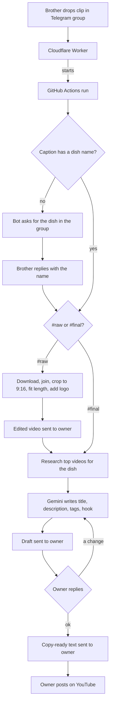

# Dolladabbe YouTube pipeline

Takes recipe clips dropped in a Telegram group and turns them into YouTube
Shorts that are ready to post: edited (if raw), researched, and packaged with
a title, description, tags and an on-screen hook. You control everything from
Telegram. It runs on free tiers only.

## Contents

1. [Status](#1-status)
2. [Who does what](#2-who-does-what)
3. [The flow, end to end](#3-the-flow-end-to-end)
4. [Guide for the person sending clips](#4-guide-for-the-person-sending-clips)
5. [Guide for the owner](#5-guide-for-the-owner)
6. [Telegram commands](#6-telegram-commands)
7. [When something goes wrong](#7-when-something-goes-wrong)
8. [One-time setup](#8-one-time-setup)
9. [First test](#9-first-test)
10. [Settings you can change](#10-settings-you-can-change)
11. [Costs and limits](#11-costs-and-limits)
12. [Roadmap](#12-roadmap)
13. [Project layout and tests](#13-project-layout-and-tests)

---

## 1. Status

**Built (phase 1):** pickup from Telegram, editing of raw clips, research,
writing, approval, and Telegram control.

**Not built yet:** automatic upload to YouTube, analytics, lessons, weekly
reports, monthly compilations. See the [roadmap](#12-roadmap). Until upload is
built, you post each approved video by hand from the YouTube app.

**Tested so far:** the logic (23 unit tests) and the video joining on sample
clips. The live connections to Telegram, Gemini and YouTube have not run yet,
because they need your credentials. Expect some fixes on the first real run.

## 2. Who does what

| Person | What they do | Where |
|---|---|---|
| Brother (sender) | Drops clips with a caption | The Telegram clips group |
| Owner (you) | Approves or corrects drafts, gives instructions, posts the video | Private chat with the bot |
| Mom | Nothing new | - |
| The pipeline | Everything else | GitHub Actions |

Only the owner's Telegram account can give instructions. Messages from anyone
else in a private chat are ignored.

## 3. The flow, end to end



Step by step:

1. **Clip arrives.** The sender posts a video in the group. Telegram notifies
   the Cloudflare Worker within seconds.
2. **Worker filters.** It ignores ordinary chat. It only wakes the pipeline for
   videos in the group, replies in the group, and the owner's private messages.
3. **Pipeline starts.** A GitHub Actions run begins. This usually takes a
   minute or two to respond.
4. **Dish name.** Taken from the caption. If the caption has none, the bot asks
   in the group and waits for a reply to that question.
5. **Editing (`#raw` only).** The clips are downloaded, joined in the order
   sent, cropped to 9:16, fitted to the target length, and given the logo. The
   edited video is sent to the owner's private chat.
6. **Research.** The pipeline searches YouTube for recent short videos of that
   dish in India and ranks them by views per subscriber, so small channels
   that broke out count for more than big channels' ordinary uploads.
7. **Writing.** Gemini gets the research, `voice.md`, and the owner's standing
   rules, and writes a title, two alternative titles, an on-screen hook, a
   description and tags.
8. **Approval.** The draft goes to the owner's private chat. Reply `ok` to
   approve, or reply with a change and a new draft comes back.
9. **Posting.** After approval the bot sends the title, description and tags as
   three separate messages for easy copying. The owner posts from the YouTube
   app.
10. **State saved.** Every run commits the clip's record to `state/` in the
    repo, so nothing is lost between runs.

## 4. Guide for the person sending clips

Post the video in the clips group with a caption: the dish name plus one tag.

| You send | Caption | What happens |
|---|---|---|
| One finished reel | `Paneer bhurji #final` | Used exactly as it is |
| One raw clip | `Paneer bhurji #raw` | Cropped to 9:16, logo added |
| Several raw clips of one dish | Select them together so they go as **one album**, one caption: `Paneer bhurji #raw` | Joined into one video |
| Anything without a caption | - | The bot asks "Which dish is this?" - **reply to that message** with the name |

Rules to remember:

- No tag means `#final`.
- For several raw clips, the `#raw` tag is required. Without it each clip in
  the album is treated as its own finished reel.
- Clips are joined in the order they appear in the album, so select them in
  cooking order. An album holds at most 10 clips.
- Send one dish per album.
- Write the dish name the way people search for it: `Dal tadka`, not `video 3`.

## 5. Guide for the owner

Everything happens in your **private chat with the bot**.

### Approving a draft

Each draft looks like this:

```
Draft for clip 123: Dal tadka

Title:
...
Other options:
  - ...
  - ...
On-screen hook: ...
Description:
...
Tags: ...
```

- **To approve:** reply to the draft with `ok` (also accepted: `okay`, `yes`,
  `approve`, `approved`, `done`).
- **To change it:** reply to the draft with what you want, in plain words:
  `use the second title`, `make it Hinglish`, `shorter description`.
  A new draft arrives. Repeat until you are happy, then reply `ok` to the
  newest draft.

You must use Telegram's **reply** on the draft message. A plain message that is
not a reply is treated as a command.

### Posting (until auto-upload is built)

After `ok` you get three messages: title, description, tags. Open the YouTube
app, upload the video, and paste them in.

- For `#final` clips, use the video from the group.
- For `#raw` clips, use the edited video the bot sent you.

### How raw clips are fitted to length

The target length is 40 seconds by default.

| Total footage | What the pipeline does | Sound |
|---|---|---|
| Up to the target | Joins the clips as they are | Kept (if every clip has sound) |
| Longer than the target | Speeds everything up, 4x at most | Removed - add music when posting |
| Still too long at 4x | Also keeps only the middle part of each clip | Removed |

The message that comes with the edited video says which of these happened.
The pipeline cannot choose the best moments, so for long footage a
hand-edited `#final` reel will look better.

### Giving standing instructions

Rules that apply to every future draft:

- `/instruct Always write titles in Hinglish`
- `/instruct Never use the word "easy"`

See them with `/instructions`, delete one with `/forget 2`.

You can also type in plain words, for example `pause everything` or
`what's pending?`. Gemini maps the message to the matching command.

## 6. Telegram commands

| Command | What it does |
|---|---|
| `/help` | Lists the commands |
| `/status` | Shows clips that are pending or recently handled, with their ids |
| `/pause` | Holds all new clips without processing them |
| `/resume` | Starts processing new clips again |
| `/redo <clip id>` | Re-runs research and writing for a clip |
| `/length <seconds>` | Target length for videos made from `#raw` clips (10 to 180) |
| `/instruct <rule>` | Saves a standing rule for all future drafts |
| `/instructions` | Lists the saved rules, numbered |
| `/forget <number>` | Deletes a saved rule |

Clip statuses you will see in `/status`:

| Status | Meaning |
|---|---|
| `awaiting_dish` | Waiting for the dish name in the group |
| `awaiting_approval` | Draft sent, waiting for your reply |
| `approved` | You approved it; post it |
| `held` | Arrived while paused |
| `failed` | Something broke; see the error message |

## 7. When something goes wrong

| What you see | Why | What to do |
|---|---|---|
| `Clip 123 failed: ...` | A download, edit, research or writing step broke | Send `/redo 123`. If it fails again, the error text says which service |
| `Paused: clip 123 is held` | A clip arrived while paused | `/resume`, then `/redo 123` |
| No reply for several minutes | GitHub Actions is slow, or the chain is broken | Check the repo's Actions tab for a failed or missing run |
| No run appears in Actions at all | The Worker did not start it | Check the Worker's secrets and that the webhook is set (setup step 4) |
| Bot never sees clips in the group | Privacy mode is still on | BotFather `/setprivacy` -> Disable, then remove and re-add the bot |
| `I didn't understand that` | The message matched no command | Use a slash command from the table |
| Draft is in the wrong language or tone | `voice.md` or rules need updating | Edit `voice.md` or add a rule with `/instruct` |
| The same clip sent twice | - | The second copy is a new message, so it gets its own draft. Ignore it |

## 8. One-time setup

About an hour. Easier on a laptop than a phone.

**Never paste tokens or keys into a chat or commit them to the repo.** They go
only into GitHub and Cloudflare secrets.

### Step 1 - Telegram

1. Message **@BotFather**, send `/newbot`, follow the prompts, and save the
   token. This is `TG_BOT_TOKEN`.
2. In BotFather send `/setprivacy`, pick the bot, choose **Disable**. Without
   this the bot cannot see videos in the group.
3. Add the bot to the clips group.
4. Open a private chat with the bot and press **Start**. The bot cannot message
   you until you do.
5. Find two ids (bots such as @userinfobot show them):
   - your own user id -> `TG_OWNER_ID`
   - the group's id -> `TG_CHAT_ID` (starts with `-100` for supergroups)
6. Go to https://my.telegram.org -> **API development tools**, create an app,
   and save `TG_API_ID` and `TG_API_HASH`. These are needed for `#raw` clips
   and albums.

### Step 2 - Google

1. In Google Cloud console, create a project.
2. Enable **YouTube Data API v3**.
3. Under Credentials, create an **API key**. This is `YT_API_KEY`.
4. Submit the **YouTube API compliance audit** form now. Without it, videos
   uploaded through the API stay private, so auto-upload cannot work.
5. In Google AI Studio, create a Gemini API key. This is `GEMINI_API_KEY`.
6. Note which Flash model is on the free tier; you will set it as
   `GEMINI_MODEL`.

### Step 3 - GitHub

1. Create a **private** repo and push this folder to it.
2. In the repo: Settings -> Secrets and variables -> Actions.
3. Add these **secrets**:

   | Secret | From |
   |---|---|
   | `TG_BOT_TOKEN` | Step 1.1 |
   | `TG_OWNER_ID` | Step 1.5 |
   | `TG_CHAT_ID` | Step 1.5 |
   | `TG_API_ID` | Step 1.6 |
   | `TG_API_HASH` | Step 1.6 |
   | `YT_API_KEY` | Step 2.3 |
   | `GEMINI_API_KEY` | Step 2.5 |

4. Add one **variable**: `GEMINI_MODEL` (Step 2.6).
5. Create a fine-grained personal access token limited to this repo, with
   **Contents: Read and write**. This is `GH_TOKEN`; it is used only by the
   Worker.

### Step 4 - Cloudflare Worker

1. Create a free Cloudflare account and a new Worker.
2. Paste the contents of `worker/worker.js` and deploy. Copy the Worker's URL.
3. Add these Worker **secrets**:

   | Secret | Value |
   |---|---|
   | `TG_WEBHOOK_SECRET` | Any long random string you make up |
   | `TG_CHAT_ID` | Same as in GitHub |
   | `TG_OWNER_ID` | Same as in GitHub |
   | `GH_REPO` | `your-username/your-repo` |
   | `GH_TOKEN` | Step 3.5 |

4. Tell Telegram to send updates to the Worker. Open this once in a browser,
   with your values filled in:

   ```
   https://api.telegram.org/bot<TG_BOT_TOKEN>/setWebhook?url=<WORKER_URL>&secret_token=<TG_WEBHOOK_SECRET>
   ```

   The page should show `"ok":true`.

### Step 5 - Your content

1. Edit `voice.md`: language, tone, audience, words to avoid.
2. Optional: add your logo as `assets/logo.png` (transparent PNG). It is placed
   at the top right of videos made from `#raw` clips.

## 9. First test

Do these in order. Stop at the first one that fails.

1. Send `/help` to the bot. A reply within a minute or two means Telegram ->
   Worker -> GitHub -> Telegram works.
2. Send `/status`. It should say `Nothing pending.`
3. Post one finished reel in the group with a caption like `Dal tadka #final`.
   A draft should arrive in your private chat.
4. Reply to the draft with a change, then reply `ok` to the new draft.
5. Post one clip with no caption. The bot should ask for the dish in the group.
6. Post two short clips as an album with `Test #raw`. You should receive one
   joined video and one draft.

If a step fails, open the repo's **Actions** tab, open the latest run, and read
the red step. That log says what broke.

## 10. Settings you can change

| What | Where | How |
|---|---|---|
| Channel voice | `voice.md` | Edit the file in the repo |
| Standing rules | Telegram | `/instruct`, `/instructions`, `/forget` |
| Raw video length | Telegram | `/length <seconds>` |
| Pause and resume | Telegram | `/pause`, `/resume` |
| Logo | `assets/logo.png` | Add or replace the file |
| Gemini model | GitHub repo variable `GEMINI_MODEL` | Change the value |

State is stored in the repo: `state/settings.json` for settings and one file
per clip in `state/videos/`. You can read them, but let the pipeline write them.

## 11. Costs and limits

- **GitHub Actions:** a private repo on the free plan gets 2,000 minutes a
  month. Each clip or command uses about a minute; raw edits use more.
- **Gemini:** free tier, a few calls per clip. Google has cut free limits
  before, which is why the model is a setting.
- **YouTube Data API:** free; research uses a small part of the daily quota.
- **Cloudflare Workers:** free plan.
- **Telegram:** files up to 2 GB.

Things it cannot do:

- Guarantee views. It copies patterns that are working and learns from yours.
- Choose the best moments in raw footage.
- Upload to YouTube yet (phase 2).

## 12. Roadmap

| Phase | What it adds | Depends on |
|---|---|---|
| 1 (built) | Pickup, raw editing, research, writing, approval, Telegram control | - |
| 2 | YouTube upload, scheduling to fixed weekly slots | YouTube audit approval |
| 3 | Analytics, 7-day post-mortem per video, lessons applied to later videos, weekly report and "shoot next week" brief | Phase 2 |
| 4 | Monthly compilation of the best clips as a long video | Phase 3 |
| Later | Title checks, hook scoring and outlier ranking from `Jakeschincariol/youtube-agent-skill` (MIT), after a code review | - |

## 13. Project layout and tests

```
.github/workflows/telegram.yml   Runs the pipeline for each Telegram update
worker/worker.js                 Cloudflare Worker: Telegram -> GitHub
pipeline/handle_update.py        Router: clips, replies, commands
pipeline/media.py                Download, join, crop, upload (Telethon + ffmpeg)
pipeline/research.py             YouTube search and ranking
pipeline/writer.py               Gemini: drafts and plain-word commands
pipeline/tg.py                   Telegram text messages
pipeline/state.py                Reads and writes state/
pipeline/config.py               Reads secrets from the environment
state/                           Settings and one record per clip
voice.md                         Channel voice
assets/logo.png                  Optional logo
tests/test_logic.py              Unit tests
```

Run the tests:

```
pip install -r requirements.txt pytest
python -m pytest -q
```
